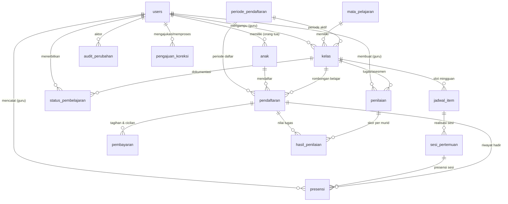

# Kamus Data & Dokumentasi Skema Database Siedu

> **Database Engine:** PostgreSQL 15+ (Supabase)
> **ORM / Data Layer:** Prisma Next (Prisma 8 - `@prisma/orm-postgres`)
> **Berkas Kontrak Sumber:** [`src/prisma/contract.prisma`](../../src/prisma/contract.prisma)
> **Terakhir Diperbarui:** 23 November 2026
> **Total Tabel Publik:** **16 tabel inti**

---

## 1. Diagram Relasi Entitas (ERD Inti)

---

## 2. Pengelompokan Modul Fungsional (16 Tabel Inti)

1. **Modul Pengguna & Akun (1 tabel):** `users` *(token reset sandi terintegrasi langsung)*
2. **Modul Master Akademik & Siswa (3 tabel):** `anak`, `mata_pelajaran`, `periode_pendaftaran`
3. **Modul Kelas & Penjadwalan (3 tabel):** `kelas`, `jadwal_item`, `sesi_pertemuan` *(jurnal materi & PR terintegrasi)*
4. **Modul Pendaftaran & Pembayaran (2 tabel):** `pendaftaran`, `pembayaran`
5. **Modul Absensi (1 tabel):** `presensi`
6. **Modul Penilaian & Evaluasi (2 tabel):** `penilaian`, `hasil_penilaian`
7. **Modul Feed & Komunikasi (2 tabel):** `status_pembelajaran` *(penerima diturunkan via pendaftaran kelas)*, `pesan_kontak`
8. **Modul Tata Kelola & Audit (2 tabel):** `audit_perubahan` *(jejak audit & laporan foto privat)*, `pengajuan_koreksi`

---

## 3. Rincian 16 Tabel dan Atribut

### 3.1. Tabel `users`

Menyimpan seluruh identitas akun pengguna sistem (Admin, Guru, Orang Tua / Wali) beserta status autentikasi dan token pemulihan sandi.

| Atribut (DB)              | Atribut (Prisma)         | Tipe Data Postgres | Nullable | Default           | Keterangan & Constraint                              |
| :------------------------ | :----------------------- | :----------------- | :------: | :---------------- | :--------------------------------------------------- |
| `id`                      | `id`                     | `integer`          |    NO    | `autoincrement()` | **Primary Key**                                      |
| `role`                    | `role`                   | `text`             |    NO    | -                 | Check: `'admin'`, `'guru'`, `'orang_tua'`            |
| `name`                    | `name`                   | `text`             |    NO    | -                 | Check: `length(name) <= 100`                         |
| `email`                   | `email`                  | `text`             |    NO    | -                 | **Unique**, Check: `length(email) <= 255`            |
| `password`                | `password`               | `text`             |    NO    | -                 | Hash kata sandi bcrypt                               |
| `nomor_telepon`           | `nomorTelepon`           | `text`             |    NO    | -                 | **Unique**, Check: `length(nomor_telepon) <= 20`     |
| `alamat`                  | `alamat`                 | `text`             |   YES    | `NULL`            | Check: `length(alamat) <= 500`                       |
| `email_verified_at`       | `emailVerifiedAt`        | `timestamptz`      |   YES    | `NULL`            | Waktu verifikasi email Google OAuth                  |
| `privasi_disetujui_at`    | `privasiDisetujuiAt`     | `timestamptz`      |   YES    | `NULL`            | Timestamp persetujuan kebijakan privasi              |
| `wali_disetujui_at`       | `waliDisetujuiAt`        | `timestamptz`      |   YES    | `NULL`            | Timestamp persetujuan tanggung jawab wali            |
| `google_sub`              | `googleSub`              | `text`             |   YES    | `NULL`            | **Unique**, Identifier sub akun Google OAuth         |
| `reset_token_hash`        | `resetTokenHash`         | `text`             |   YES    | `NULL`            | **Unique**, Hash token pemulihan sandi aktif (1 jam) |
| `reset_token_expires_at`  | `resetTokenExpiresAt`    | `timestamptz`      |   YES    | `NULL`            | Batas waktu kedaluwarsa token reset sandi            |
| `created_at`              | `createdAt`              | `timestamptz`      |    NO    | `now()`           | Waktu registrasi                                     |
| `updated_at`              | `updatedAt`              | `timestamptz`      |    NO    | `now()`           | Waktu pembaruan profil                               |

- **Index Khusus:** `users_email_lower` (`CREATE UNIQUE INDEX ... ON users (lower(email))`).

---

### 3.2. Tabel `anak`

Data profil anak / siswa bimbel yang terhubung dengan orang tua.

| Atribut (DB)       | Atribut (Prisma)  | Tipe Data     | Nullable | Default           | Keterangan & Constraint                         |
| :----------------- | :---------------- | :------------ | :------: | :---------------- | :---------------------------------------------- |
| `id`               | `id`              | `integer`     |    NO    | `autoincrement()` | **Primary Key**                                 |
| `orang_tua_id`     | `orangTuaId`      | `integer`     |    NO    | -                 | **FK** -> `users(id)` ON DELETE CASCADE         |
| `nama`             | `nama`            | `text`        |    NO    | -                 | Check: `length(nama) <= 100`                    |
| `tanggal_lahir`    | `tanggalLahir`    | `date`        |    NO    | -                 | Check: `tanggal_lahir <= CURRENT_DATE`          |
| `jenjang_terakhir` | `jenjangTerakhir` | `text`        |   YES    | `NULL`            | Check: `'TK'`, `'SD'`, `'SMP'`, `'SMA'`         |
| `tingkat`          | `tingkat`         | `text`        |   YES    | `NULL`            | Check: `length(tingkat) <= 30` (mis: "Kelas 4") |
| `persetujuan_foto` | `persetujuanFoto` | `boolean`     |    NO    | `false`           | Izin publikasi foto kegiatan privat             |
| `email_notifikasi` | `emailNotifikasi` | `text`        |   YES    | `NULL`            | Check: `length <= 255` (kontak opsional siswa)  |
| `nomor_telepon`    | `nomorTelepon`    | `text`        |   YES    | `NULL`            | Check: `length <= 20` (nomor WA siswa)          |
| `created_at`       | `createdAt`       | `timestamptz` |    NO    | `now()`           | Waktu pembuatan data anak                       |
| `updated_at`       | `updatedAt`       | `timestamptz` |    NO    | `now()`           | Waktu perubahan data                            |

---

### 3.3. Tabel `mata_pelajaran`

Master katalog mata pelajaran bimbel.

| Atribut (DB) | Atribut (Prisma) | Tipe Data     | Nullable | Default           | Keterangan & Constraint                  |
| :----------- | :--------------- | :------------ | :------: | :---------------- | :--------------------------------------- |
| `id`         | `id`             | `integer`     |    NO    | `autoincrement()` | **Primary Key**                          |
| `nama`       | `nama`           | `text`        |    NO    | -                 | **Unique**, Check: `length(nama) <= 100` |
| `deskripsi`  | `deskripsi`      | `text`        |   YES    | `NULL`            | Check: `length(deskripsi) <= 500`        |
| `created_at` | `createdAt`      | `timestamptz` |    NO    | `now()`           | Waktu penambahan mapel                   |
| `updated_at` | `updatedAt`      | `timestamptz` |    NO    | `now()`           | Waktu pembaruan data                     |

---

### 3.4. Tabel `periode_pendaftaran`

Semester / rentang kalender operasional pendaftaran dan kegiatan belajar.

| Atribut (DB)                | Atribut (Prisma)          | Tipe Data     | Nullable | Default           | Keterangan & Constraint                     |
| :-------------------------- | :------------------------ | :------------ | :------: | :---------------- | :------------------------------------------ |
| `id`                        | `id`                      | `integer`     |    NO    | `autoincrement()` | **Primary Key**                             |
| `nama`                      | `nama`                    | `text`        |    NO    | -                 | Check: `length(nama) <= 100`                |
| `tanggal_mulai`             | `tanggalMulai`            | `date`        |    NO    | -                 | Tanggal mulai belajar semester              |
| `tanggal_selesai`           | `tanggalSelesai`          | `date`        |    NO    | -                 | Tanggal akhir periode                       |
| `tanggal_tutup_pendaftaran` | `tanggalTutupPendaftaran` | `date`        |    NO    | -                 | Batas akhir pendaftaran                     |
| `status`                    | `status`                  | `text`        |    NO    | `'dibuka'`        | Check: `'dibuka'`, `'ditutup'`, `'selesai'` |
| `created_at`                | `createdAt`               | `timestamptz` |    NO    | `now()`           | Waktu pembuatan periode                     |
| `updated_at`                | `updatedAt`               | `timestamptz` |    NO    | `now()`           | Waktu perubahan data                        |

- **Constraints:** `tanggal_mulai < tanggal_selesai`, `tanggal_tutup_pendaftaran <= tanggal_selesai`.

---

### 3.5. Tabel `kelas`

Rombongan belajar (rombel) yang dibuka dalam suatu periode.

| Atribut (DB)        | Atribut (Prisma)  | Tipe Data     | Nullable | Default           | Keterangan & Constraint                                |
| :------------------ | :---------------- | :------------ | :------: | :---------------- | :----------------------------------------------------- |
| `id`                | `id`              | `integer`     |    NO    | `autoincrement()` | **Primary Key**                                        |
| `mata_pelajaran_id` | `mataPelajaranId` | `integer`     |    NO    | -                 | **FK** -> `mata_pelajaran(id)` ON DELETE RESTRICT      |
| `guru_id`           | `guruId`          | `integer`     |    NO    | -                 | **FK** -> `users(id)` ON DELETE RESTRICT               |
| `periode_id`        | `periodeId`       | `integer`     |    NO    | -                 | **FK** -> `periode_pendaftaran(id)` ON DELETE RESTRICT |
| `jenjang`           | `jenjang`         | `text`        |    NO    | -                 | Check: `'TK'`, `'SD'`, `'SMP'`, `'SMA'`                |
| `tingkat`           | `tingkat`         | `text`        |   YES    | `NULL`            | Check: `length <= 30` (misal: "Kelas 5-6")             |
| `ruangan`           | `ruangan`         | `text`        |   YES    | `NULL`            | Check: `length <= 50` (lokasi fisik ruang ajar)        |
| `kuota_maksimum`    | `kuotaMaksimum`   | `integer`     |    NO    | -                 | Batas daya tampung siswa                               |
| `kuota_minimum`     | `kuotaMinimum`    | `integer`     |    NO    | -                 | Batas kelayakan buka kelas                             |
| `kuota_terisi`      | `kuotaTerisi`     | `integer`     |    NO    | `0`               | Jumlah siswa yang terdaftar aktif                      |
| `biaya_periode`     | `biayaPeriode`    | `numeric`     |    NO    | -                 | Biaya total kelas per periode (Check: `> 0`)           |
| `biaya_dp`          | `biayaDp`         | `numeric`     |   YES    | `NULL`            | Besaran DP jika cicilan (Check: `< biaya_periode`)     |
| `tenor_maksimum`    | `tenorMaksimum`   | `integer`     |   YES    | `NULL`            | Jumlah bulan cicilan (Check: `>= 2`)                   |
| `status`            | `status`          | `text`        |    NO    | `'aktif'`         | Check: `'aktif'`, `'dibatalkan'`                       |
| `created_at`        | `createdAt`       | `timestamptz` |    NO    | `now()`           | Waktu pembuatan kelas                                  |
| `updated_at`        | `updatedAt`       | `timestamptz` |    NO    | `now()`           | Waktu pembaruan data                                   |

---

### 3.6. Tabel `jadwal_item`

Pola jadwal rutin mingguan dari suatu kelas (1 kelas bisa memiliki 1–3 slot jadwal per minggu).

| Atribut (DB)  | Atribut (Prisma) | Tipe Data | Nullable | Default           | Keterangan & Constraint                                |
| :------------ | :--------------- | :-------- | :------: | :---------------- | :----------------------------------------------------- |
| `id`          | `id`             | `integer` |    NO    | `autoincrement()` | **Primary Key**                                        |
| `kelas_id`    | `kelasId`        | `integer` |    NO    | -                 | **FK** -> `kelas(id)` ON DELETE CASCADE                |
| `hari`        | `hari`           | `text`    |    NO    | -                 | Check: `'Senin'` s.d. `'Minggu'`                       |
| `jam_mulai`   | `jamMulai`       | `time`    |    NO    | -                 | Jam mulai belajar (HH:MM)                              |
| `jam_selesai` | `jamSelesai`     | `time`    |    NO    | -                 | Jam selesai belajar (Check: `jam_mulai < jam_selesai`) |

- **Unique Constraint:** `(kelas_id, hari, jam_mulai, jam_selesai)`.

---

### 3.7. Tabel `sesi_pertemuan`

Pertemuan belajar riil di kalender yang dibentuk dari `jadwal_item` sepanjang rentang tanggal periode, lengkap dengan jurnal materi dan pekerjaan rumah (PR) per sesi.

| Atribut (DB)               | Atribut (Prisma)          | Tipe Data     | Nullable | Default           | Keterangan & Constraint                           |
| :------------------------- | :------------------------ | :------------ | :------: | :---------------- | :------------------------------------------------ |
| `id`                       | `id`                      | `integer`     |    NO    | `autoincrement()` | **Primary Key**                                   |
| `jadwal_item_id`           | `jadwalItemId`            | `integer`     |    NO    | -                 | **FK** -> `jadwal_item(id)` ON DELETE RESTRICT    |
| `tanggal_pertemuan`        | `tanggalPertemuan`        | `date`        |    NO    | -                 | Tanggal sesi nyata berlangsung (YYYY-MM-DD)       |
| `status_sesi`              | `statusSesi`              | `text`        |    NO    | `'terjadwal'`     | Check: `'terjadwal'`, `'selesai'`, `'dibatalkan'` |
| `jam_mulai`                | `jamMulai`                | `time`        |    NO    | -                 | Snapshot jam mulai sesi saat dibentuk             |
| `jam_selesai`              | `jamSelesai`              | `time`        |    NO    | -                 | Snapshot jam selesai sesi saat dibentuk           |
| `dibatalkan_alasan`        | `dibatalkanAlasan`        | `text`        |   YES    | `NULL`            | Alasan jika sesi dibatalkan guru/admin            |
| `catatan_materi`           | `catatanMateri`           | `text`        |   YES    | `NULL`            | Rangkuman materi ajar guru (Check: `<= 2000` char)|
| `catatan_pr`               | `catatanPr`               | `text`        |   YES    | `NULL`            | Tugas/PR murid (Check: `<= 1000` char)            |
| `catatan_draf`             | `catatanDraf`             | `boolean`     |    NO    | `true`            | Status draf jurnal (false = dipublikasikan)       |
| `catatan_diterbitkan_pada` | `catatanDiterbitkanPada`  | `timestamptz` |   YES    | `NULL`            | Waktu jurnal dipublikasikan ke portal wali        |
| `created_at`               | `createdAt`               | `timestamptz` |    NO    | `now()`           | Waktu sesi digenerate                             |
| `updated_at`               | `updatedAt`               | `timestamptz` |    NO    | `now()`           | Waktu perubahan status sesi                       |

- **Unique Constraint:** `(jadwal_item_id, tanggal_pertemuan)`.

---

### 3.8. Tabel `pendaftaran`

Entri pendaftaran seorang anak ke dalam kelas tertentu pada periode tertentu.

| Atribut (DB)          | Atribut (Prisma)    | Tipe Data     | Nullable | Default                 | Keterangan & Constraint                                |
| :-------------------- | :------------------ | :------------ | :------: | :---------------------- | :----------------------------------------------------- |
| `id`                  | `id`                | `integer`     |    NO    | `autoincrement()`       | **Primary Key**                                        |
| `anak_id`             | `anakId`            | `integer`     |    NO    | -                       | **FK** -> `anak(id)` ON DELETE RESTRICT                |
| `kelas_id`            | `kelasId`           | `integer`     |    NO    | -                       | **FK** -> `kelas(id)` ON DELETE RESTRICT               |
| `periode_id`          | `periodeId`         | `integer`     |    NO    | -                       | **FK** -> `periode_pendaftaran(id)` ON DELETE RESTRICT |
| `jenjang_saat_daftar` | `jenjangSaatDaftar` | `text`        |    NO    | -                 | Check: `'TK'`, `'SD'`, `'SMP'`, `'SMA'`                |
| `metode_bayar`        | `metodeBayar`       | `text`        |    NO    | -                 | Check: `'lunas'`, `'dp_cicilan'`                       |
| `tenor_bulan`         | `tenorBulan`        | `integer`     |   YES    | `NULL`                  | Durasi bulan cicilan (wajib jika `dp_cicilan`)         |
| `status`              | `status`            | `text`        |    NO    | `'menunggu_pembayaran'` | Status pendaftaran (lihat tabel status)                |
| `created_at`          | `createdAt`         | `timestamptz` |    NO    | `now()`                 | Waktu formulir pendaftaran dibuat                      |
| `updated_at`          | `updatedAt`         | `timestamptz` |    NO    | `now()`                 | Waktu pembaruan status                                 |

- **Partial Unique Index:** `pendaftaran_aktif_unique` (anak tidak boleh terdaftar ganda di kelas yang sama pada periode yang sama kecuali status dibatalkan).

---

### 3.9. Tabel `pembayaran`

Faktur tagihan dan riwayat transaksi pembayaran bimbel.

| Atribut (DB)        | Atribut (Prisma)   | Tipe Data     | Nullable | Default           | Keterangan & Constraint                         |
| :------------------ | :----------------- | :------------ | :------: | :---------------- | :---------------------------------------------- |
| `id`                | `id`               | `integer`     |    NO    | `autoincrement()` | **Primary Key**                                 |
| `pendaftaran_id`    | `pendaftaranId`    | `integer`     |    NO    | -                 | **FK** -> `pendaftaran(id)` ON DELETE RESTRICT  |
| `tipe`              | `tipe`             | `text`        |    NO    | -                 | Check: `'dp'`, `'cicilan'`, `'lunas'`           |
| `cicilan_ke`        | `cicilanKe`        | `integer`     |   YES    | `NULL`            | Angka cicilan (1, 2, ...), NULL jika DP/Lunas   |
| `jumlah`            | `jumlah`           | `numeric`     |    NO    | -                 | Tagihan rupiah (Check: `jumlah > 0`)            |
| `jatuh_tempo`       | `jatuhTempo`       | `date`        |   YES    | `NULL`            | Tanggal batas akhir pembayaran                  |
| `dibayar_pada`      | `dibayarPada`      | `timestamptz` |   YES    | `NULL`            | Timestamp pelunasan dari payment gateway        |
| `status`            | `status`           | `text`        |    NO    | `'pending'`       | Check: `'pending'`, `'berhasil'`, `'gagal'`     |
| `referensi_gateway` | `referensiGateway` | `text`        |   YES    | `NULL`            | **Unique**, Order ID Midtrans / payment gateway |
| `created_at`        | `createdAt`        | `timestamptz` |    NO    | `now()`           | Waktu invoice dibuat                            |
| `updated_at`        | `updatedAt`        | `timestamptz` |    NO    | `now()`           | Waktu callback/update status                    |

---

### 3.10. Tabel `presensi`

Pencatatan absensi kehadiran siswa pada pertemuan belajar.

| Atribut (DB)        | Atribut (Prisma)   | Tipe Data     | Nullable | Default           | Keterangan & Constraint                           |
| :------------------ | :----------------- | :------------ | :------: | :---------------- | :------------------------------------------------ |
| `id`                | `id`               | `integer`     |    NO    | `autoincrement()` | **Primary Key**                                   |
| `pendaftaran_id`    | `pendaftaranId`    | `integer`     |    NO    | -                 | **FK** -> `pendaftaran(id)` ON DELETE CASCADE     |
| `jadwal_item_id`    | `jadwalItemId`     | `integer`     |    NO    | -                 | **FK** -> `jadwal_item(id)` ON DELETE RESTRICT    |
| `sesi_pertemuan_id` | `sesiPertemuanId`  | `integer`     |   YES    | `NULL`            | **FK** -> `sesi_pertemuan(id)` ON DELETE SET NULL |
| `dicatat_oleh`      | `dicatatOleh`      | `integer`     |    NO    | -                 | **FK** -> `users(id)` (Guru pencatat)             |
| `tanggal_pertemuan` | `tanggalPertemuan` | `date`        |    NO    | -                 | Tanggal absensi                                   |
| `status`            | `status`           | `text`        |    NO    | -                 | Check: `'hadir'`, `'izin'`, `'sakit'`, `'alpa'`   |
| `catatan`           | `catatan`          | `text`        |   YES    | `NULL`            | Check: `length(catatan) <= 255`                   |
| `created_at`        | `createdAt`        | `timestamptz` |    NO    | `now()`           | Waktu presensi disimpan                           |
| `updated_at`        | `updatedAt`        | `timestamptz` |    NO    | `now()`           | Waktu perubahan absensi                           |

- **Unique Constraint:** `(pendaftaran_id, tanggal_pertemuan, jadwal_item_id)`.

---

### 3.11. Tabel `penilaian`

Header tugas, kuis, atau evaluasi belajar yang diselenggarakan guru dalam satu kelas.

| Atribut (DB)       | Atribut (Prisma)  | Tipe Data     | Nullable | Default           | Keterangan & Constraint                 |
| :----------------- | :---------------- | :------------ | :------: | :---------------- | :-------------------------------------- |
| `id`               | `id`              | `integer`     |    NO    | `autoincrement()` | **Primary Key**                         |
| `kelas_id`         | `kelasId`         | `integer`     |    NO    | -                 | **FK** -> `kelas(id)` ON DELETE CASCADE |
| `nama`             | `nama`            | `text`        |    NO    | -                 | Judul tugas/kuis (Check: `<= 100` char) |
| `tanggal`          | `tanggal`         | `date`        |    NO    | -                 | Tanggal pelaksanaan penilaian           |
| `nilai_maksimum`   | `nilaiMaksimum`   | `numeric`     |    NO    | `'100'`           | Batas skor tertinggi (Check: `> 0`)     |
| `draf`             | `draf`            | `boolean`     |    NO    | `true`            | Status publikasi nilai                  |
| `diterbitkan_pada` | `diterbitkanPada` | `timestamptz` |   YES    | `NULL`            | Waktu nilai dirilis ke orang tua        |
| `dibuat_oleh`      | `dibuatOleh`      | `integer`     |    NO    | -                 | **FK** -> `users(id)` (Guru pembuat)    |
| `created_at`       | `createdAt`       | `timestamptz` |    NO    | `now()`           | Waktu penilaian dibuat                  |
| `updated_at`       | `updatedAt`       | `timestamptz` |    NO    | `now()`           | Waktu pembaruan data                    |

---

### 3.12. Tabel `hasil_penilaian`

Skor nilai per siswa yang terhubung ke induk `penilaian`.

| Atribut (DB)     | Atribut (Prisma) | Tipe Data     | Nullable | Default           | Keterangan & Constraint                               |
| :--------------- | :--------------- | :------------ | :------: | :---------------- | :---------------------------------------------------- |
| `id`             | `id`             | `integer`     |    NO    | `autoincrement()` | **Primary Key**                                       |
| `penilaian_id`   | `penilaianId`    | `integer`     |    NO    | -                 | **FK** -> `penilaian(id)` ON DELETE CASCADE           |
| `pendaftaran_id` | `pendaftaranId`  | `integer`     |    NO    | -                 | **FK** -> `pendaftaran(id)` ON DELETE CASCADE         |
| `status_hasil`   | `statusHasil`    | `text`        |    NO    | `'belum_dinilai'` | Check: `'belum_dinilai'`, `'dinilai'`, `'tidak_ikut'` |
| `nilai`          | `nilai`          | `numeric`     |   YES    | `NULL`            | Skor riil siswa (Check: `nilai >= 0`)                 |
| `catatan`        | `catatan`        | `text`        |   YES    | `NULL`            | Catatan evaluasi guru (Check: `<= 1000` char)         |
| `created_at`     | `createdAt`      | `timestamptz` |    NO    | `now()`           | Waktu skor dicatat                                    |
| `updated_at`     | `updatedAt`      | `timestamptz` |    NO    | `now()`           | Waktu pembaruan skor                                  |

- **Unique Constraint:** `(penilaian_id, pendaftaran_id)`.

---

### 3.13. Tabel `status_pembelajaran`

Postingan feed aktivitas dan dokumentasi kegiatan belajar di kelas.

| Atribut (DB)       | Atribut (Prisma)  | Tipe Data     | Nullable | Default           | Keterangan & Constraint                                               |
| :----------------- | :---------------- | :------------ | :------: | :---------------- | :-------------------------------------------------------------------- |
| `id`               | `id`              | `integer`     |    NO    | `autoincrement()` | **Primary Key**                                                       |
| `kelas_id`         | `kelasId`         | `integer`     |    NO    | -                 | **FK** -> `kelas(id)` ON DELETE CASCADE                               |
| `dibuat_oleh`      | `dibuatOleh`      | `integer`     |    NO    | -                 | **FK** -> `users(id)` ON DELETE RESTRICT                              |
| `konten_teks`      | `kontenTeks`      | `text`        |    NO    | -                 | Narasi kegiatan (Check: `<= 1000` char)                               |
| `media_urls`       | `mediaUrls`       | `text`        |   YES    | `NULL`            | JSON array URL gambar (maks 5 foto)                                   |
| `status`           | `status`          | `text`        |    NO    | `'aktif'`         | Check: `'aktif'`, `'diarsipkan'`, `'ditarik_admin'`, `'dihapus_guru'` |
| `diterbitkan_pada` | `diterbitkanPada` | `timestamptz` |    NO    | `now()`           | Waktu tayang feed                                                     |
| `kadaluarsa_pada`  | `kadaluarsaPada`  | `timestamptz` |    NO    | -                 | Batas waktu tampil feed (24-48 jam)                                   |
| `created_at`       | `createdAt`       | `timestamptz` |    NO    | `now()`           | Waktu dibuat                                                          |
| `updated_at`       | `updatedAt`       | `timestamptz` |    NO    | `now()`           | Waktu pembaruan                                                       |

---

### 3.14. Tabel `pesan_kontak`

Pesan masuk dari pengunjung melalui formulir kontak publik (Hubungi Kami).

| Atribut (DB) | Atribut (Prisma) | Tipe Data     | Nullable | Default           | Keterangan & Constraint                    |
| :----------- | :--------------- | :------------ | :------: | :---------------- | :----------------------------------------- |
| `id`         | `id`             | `integer`     |    NO    | `autoincrement()` | **Primary Key**                            |
| `nama`       | `nama`           | `text`        |    NO    | -                 | Nama pengirim (Check: `<= 100` char)       |
| `telepon`    | `telepon`        | `text`        |    NO    | -                 | Nomor WhatsApp/telp (Check: `<= 20` char)  |
| `email`      | `email`          | `text`        |    NO    | -                 | Alamat email (Check: `<= 255` char)        |
| `sekolah`    | `sekolah`        | `text`        |   YES    | `NULL`            | Asal sekolah anak (Check: `<= 150` char)   |
| `jenjang`    | `jenjang`        | `text`        |   YES    | `NULL`            | Check: `'TK'`, `'SD'`, `'SMP'`, `'SMA'`    |
| `subjek`     | `subjek`         | `text`        |    NO    | -                 | Judul pesan                                |
| `pesan`      | `pesan`          | `text`        |    NO    | -                 | Isi pesan (Check: `<= 2000` char)          |
| `status`     | `status`         | `text`        |    NO    | `'baru'`          | Check: `'baru'`, `'diproses'`, `'selesai'` |
| `created_at` | `createdAt`      | `timestamptz` |    NO    | `now()`           | Waktu pesan dikirim                        |
| `updated_at` | `updatedAt`      | `timestamptz` |    NO    | `now()`           | Waktu tanggapan admin                      |

---

### 3.15. Tabel `audit_perubahan`

Log jejak audit (_immutable audit trail_) atas modifikasi data sensitif sistem, termasuk pelaporan foto privat pembelajaran oleh orang tua.

| Atribut (DB) | Atribut (Prisma) | Tipe Data     | Nullable | Default           | Keterangan                                     |
| :----------- | :--------------- | :------------ | :------: | :---------------- | :--------------------------------------------- |
| `id`         | `id`             | `integer`     |    NO    | `autoincrement()` | **Primary Key**                                |
| `entitas`    | `entitas`        | `text`        |    NO    | -                 | Nama entitas yang diubah (misal: `'presensi'`) |
| `entitas_id` | `entitasId`      | `integer`     |    NO    | -                 | ID baris rekaman entitas terkait               |
| `aksi`       | `aksi`           | `text`        |    NO    | -                 | Operasi (misal: `'UPDATE'`, `'lapor_foto'`)    |
| `sebelum`    | `sebelum`        | `text`        |   YES    | `NULL`            | Nilai data sebelum perubahan (JSON/text)       |
| `sesudah`    | `sesudah`        | `text`        |   YES    | `NULL`            | Nilai data sesudah perubahan (JSON/text)       |
| `alasan`     | `alasan`         | `text`        |   YES    | `NULL`            | Alasan dilakukannya perubahan                  |
| `aktor_id`   | `aktorId`        | `integer`     |    NO    | -                 | **FK** -> `users(id)` ON DELETE RESTRICT       |
| `created_at` | `createdAt`      | `timestamptz` |    NO    | `now()`           | Waktu pencatatan audit                         |

---

### 3.16. Tabel `pengajuan_koreksi`

Tiket pengajuan koreksi presensi lampau (> 7 hari) yang diajukan oleh guru untuk direview admin.

| Atribut (DB)    | Atribut (Prisma) | Tipe Data     | Nullable | Default           | Keterangan & Constraint                         |
| :-------------- | :--------------- | :------------ | :------: | :---------------- | :---------------------------------------------- |
| `id`            | `id`             | `integer`     |    NO    | `autoincrement()` | **Primary Key**                                 |
| `guru_id`       | `guruId`         | `integer`     |    NO    | -                 | **FK** -> `users(id)` (Guru pemohon)            |
| `entitas`       | `entitas`        | `text`        |    NO    | -                 | Nama entitas (saat ini khusus: `'presensi'`)    |
| `entitas_id`    | `entitasId`      | `integer`     |    NO    | -                 | ID rekaman presensi terkait                     |
| `status`        | `status`         | `text`        |    NO    | `'menunggu'`      | Check: `'menunggu'`, `'disetujui'`, `'ditolak'` |
| `data_sebelum`  | `dataSebelum`    | `text`        |   YES    | `NULL`            | Data status presensi awal                       |
| `data_usulan`   | `dataUsulan`     | `text`        |    NO    | -                 | Status presensi baru yang diusulkan             |
| `alasan`        | `alasan`         | `text`        |    NO    | -                 | Alasan koreksi (Check: `<= 1000` char)          |
| `diproses_oleh` | `diprosesOleh`   | `integer`     |   YES    | `NULL`            | **FK** -> `users(id)` (Admin pereview)          |
| `catatan_admin` | `catatanAdmin`   | `text`        |   YES    | `NULL`            | Catatan putusan admin (Check: `<= 1000` char)   |
| `created_at`    | `createdAt`      | `timestamptz` |    NO    | `now()`           | Waktu pengajuan tiket                           |
| `updated_at`    | `updatedAt`      | `timestamptz` |    NO    | `now()`           | Waktu putusan tiket                             |

---

## 4. Konfigurasi Keamanan & Row Level Security (RLS)

- Seluruh 16 tabel di atas telah diaktifkan Row Level Security (`rls_enabled: true`).
- Siedu menggunakan pola akses direct ORM server-side (Node.js/Next.js ke database PostgreSQL) dengan kredensial aman di file `.env`.
- Supabase PostgREST Data API tidak diekspos sembarangan ke publik (`anon`), sehingga kontrol akses terisolasi ketat di lapisan Server Actions & Middleware.
